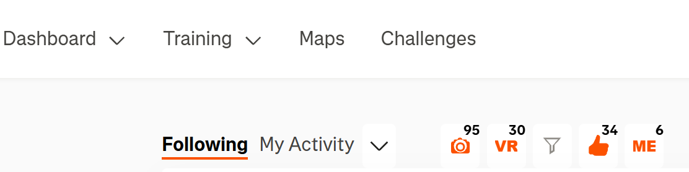

# Strava Feed Filters

Browser extension and Tampermonkey userscript for the Strava dashboard feed. Filters the feed by activity type and hides posts without photos or videos, virtual activities, posts you already gave kudos to, and your own posts. Adds a Following / My Activity toggle.

## Controls

- **Following / My Activity** tabs: switch between the two common feeds (replaces Strava's feed dropdown)
- `▾` next to the tabs: reveals Strava's original dropdown for clubs and other feed sources
- Camera: hides posts without uploaded photos or videos; pictures Strava generates itself, such as the weight-training muscle heatmap, don't count. On by default
- `VR`: hides virtual activities
- Funnel: opens the activity-type menu; unchecked types are hidden. A post is hidden only when all of its activity types are unchecked. The menu lists the types found in the loaded feed
- Thumbs-up: hides posts you already gave kudos to
- `ME`: hides your own posts

An orange button is on; its badge counts the loaded posts it hides. The kudos and `ME` filters are off on the My Activity feed, where they would hide everything. All choices are saved in the browser, and activity types you haven't seen before are shown.

## Installation

Install the browser extension:

- [Chrome Web Store](https://chromewebstore.google.com/detail/strava-feed-filters/jdefobolefeekjbgaclabbcffmebamdo)
- [Firefox Add-ons](https://addons.mozilla.org/en-US/firefox/addon/strava-feed-filters/)

Or install the Tampermonkey userscript:

1. Install [Tampermonkey](https://www.tampermonkey.net/)
2. Install the script: [**Strava Feed Filters**](https://raw.githubusercontent.com/rrokot/strava-feed-filters/main/strava-photo-filter-toggle.user.js)

Author: [rrokot](https://www.strava.com/athletes/5931245)

## License

MIT License
